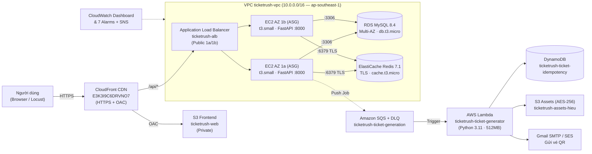

# TicketRush — Hệ Thống Đặt Vé Sự Kiện Chịu Tải Đột Biến Trên AWS

**TicketRush** là hệ thống đăng ký và đặt vé sự kiện trực tuyến được thiết kế theo kiến trúc **3 tầng (3-Tier Architecture)** kết hợp **xử lý bất đồng bộ hướng sự kiện (Event-Driven Serverless)** trên **Amazon Web Services (AWS — `ap-southeast-1`)**, đáp ứng bài toán lưu lượng đột biến (*flash-sale / spiky traffic*), tự động co giãn và đảm bảo tuyệt đối **không bán vượt số chỗ (anti-overselling)**.

- **Hệ thống triển khai (HTTPS / CloudFront):** https://d3m6e24vu2nkwf.cloudfront.net
- **Trang quản trị (Admin Dashboard):** https://d3m6e24vu2nkwf.cloudfront.net/admin.html
- **Học phần:** INT 3319 3 — Điện toán đám mây (Trường Đại học Công nghệ – ĐHQGHN)
- **Giảng viên hướng dẫn:** Trần Trúc Mai, Nguyễn Xuân Trường

---

## Thành viên thực hiện

| STT | Họ và tên | MSSV | Mảng phụ trách chính |
| :---: | :--- | :---: | :--- |
| 1 | Phan Huy Anh | `24020024` | Launch Template, Golden AMI, Auto Scaling Group, CloudWatch Dashboard & Alarms, SNS |
| 2 | Nguyễn Tất Bình | `24020042` | VPC 2 AZ, Subnets, Route Tables, NAT/IGW, Security Groups, ALB, IAM Roles, Secrets Manager |
| 3 | Trần Đức Hoàng | `24020141` | Backend FastAPI, SQS + DLQ, AWS Lambda, DynamoDB Idempotency, SMTP/SES, Locust, AWS Pricing |
| 4 | Nguyễn Văn Hiếu | `24021478` | RDS MySQL 8.4 Multi-AZ, ElastiCache Redis 7.1 TLS, S3, EBS, CloudFront OAC, Admin Dashboard, Báo cáo |

---

## Kiến trúc tổng thể trên AWS



### Hạ tầng AWS đã triển khai thực tế (`ap-southeast-1`)

| Tầng | Dịch vụ AWS | Cấu hình thực tế |
| :--- | :--- | :--- |
| **Mạng riêng** | Amazon VPC | `ticketrush-vpc` (`10.0.0.0/16`), 6 Subnets (2 Public, 2 Private App, 2 Private Data) trên 2 AZ (`1a/1b`), IGW, NAT Gateway, Security Group Chaining (`tr-alb-sg` → `tr-app-sg` → `tr-data-sg`) |
| **Biên & Cân bằng tải** | CloudFront + ALB | CloudFront `E3K3I9C6DRVNO7` (`*` → S3 OAC, `/api/*` → ALB); ALB `ticketrush-alb` chuyển tiếp `:80` → `:8000`, Health Check `GET /health` |
| **Tầng ứng dụng** | EC2 + Auto Scaling | ASG `ticketrush-asg` (`Min 2 / Max 4`, `t3.small`, Private Subnet không Public IP), Golden AMI, Target Tracking `ALBRequestCountPerTarget = 3000` (warmup `60s`) |
| **Cơ sở dữ liệu** | RDS + ElastiCache | RDS MySQL `8.4.11` (`db.t3.micro`, **Multi-AZ = Yes**, Private, `20 GiB gp3`, backup 7 ngày); Redis `7.1.0` (`cache.t3.micro`, **TLS + At-Rest**) |
| **Lưu trữ đa loại** | S3 + EBS + DynamoDB | S3 (`ticketrush-web`, `ticketrush-assets-hieu` SSE-S3 AES-256), EBS `gp3` `20 GiB` (3.000 IOPS), DynamoDB `ticketrush-ticket-idempotency` (`PAY_PER_REQUEST`, TTL 24h) |
| **Bất đồng bộ** | SQS + DLQ + Lambda | SQS `ticketrush-ticket-generation` + DLQ (`maxReceiveCount = 3`), Lambda `ticketrush-ticket-generator` (`Python 3.11`, `512 MB`, `60s`) |
| **Bảo mật & Giám sát** | IAM + Secrets + CW | IAM Roles (`ticketrush-ec2-role`, `ticketrush-lambda-execution-role`), AWS Secrets Manager, CloudWatch Dashboard `TicketRush`, 7 Alarms + Amazon SNS |

---

## Tính năng nổi bật

- **Phòng vệ 3 lớp chống bán vượt số chỗ:**
  1. Trừ ghế nguyên tử trên RAM ElastiCache Redis (`DECRBY`) kèm khóa giữ chỗ tạm thời **TTL 10 phút** (`booking:hold:{id}`).
  2. Cập nhật nguyên tử mức hàng trên RDS MySQL (`UPDATE events ... WHERE available_tickets >= :qty`).
  3. Ràng buộc toàn vẹn `CHECK (available_tickets >= 0)` ngay mức cơ sở dữ liệu.
- **Tối ưu hiệu năng & đồng bộ kết nối:**
  - Redis **Cache-Aside** cho danh sách/chi tiết sự kiện (tự động *invalidation* khi tồn kho đổi).
  - Redis **Rate Limiting** chống spam đặt vé (`10 req / 60s`, trả `HTTP 429`).
  - Giới hạn SQLAlchemy pool (`pool_size=4, max_overflow=2`) đảm bảo ở đỉnh 4 EC2 (8 workers) tổng kết nối đạt tối đa `48 < 64` trần của `db.t3.micro`.
- **Pipeline phát hành vé bất đồng bộ:** SQS + DLQ + DynamoDB Idempotency (`exactly-once`) + AWS Lambda sinh ảnh mã QR lưu S3 (`AES-256`), ký Pre-signed URL 24h và gửi email kèm ảnh QR đính kèm.
- **Admin Dashboard hoàn chỉnh:** CRUD sự kiện (tự đồng bộ bộ đếm Redis), tải ảnh poster trực tiếp lên S3 (`posters/*`), lọc đơn hàng, xuất CSV (UTF-8 BOM), gửi lại email vé và **Check-in mã QR tại cổng** (chặn quét trùng `409 Conflict`).

---

## Kết quả kiểm thử chịu tải thực tế (Locust — 600 Users)

Kiểm thử chạy liên tục ~20 phút với **600 người dùng ảo đồng thời** gom tải vào sự kiện `#22` (300 chỗ):

| Chỉ số | Kết quả thực nghiệm |
| :--- | :--- |
| **Tổng số yêu cầu** | **455.250 requests** |
| **Thông lượng ổn định** | **289,1 – 291 RPS** |
| **Độ trễ (Aggregated)** | **Median 63 ms** · **p95 130 ms** · **p99 290 ms** *(đọc sự kiện `56–58 ms`)* |
| **Tỉ lệ lỗi tổng** | **0,41%** *(**0 lỗi/giây** liên tục >10 phút sau khi mở rộng lên 4 EC2)* |
| **Auto Scaling & Self-Healing** | Tự mở rộng **2 → 4 EC2 trong 65 giây** (`EC2 CPU` đỉnh chỉ `38,39%`); tự thay node trượt Health Check trong **6 giây** |
| **Kiểm chứng chống bán lố** | RDS MySQL xác nhận đúng **300 đơn `CONFIRMED` / 300 vé đã bán / tồn kho 0** |

---

## Cấu trúc thư mục

```text
TicketRush/
├── backend/                 # Ứng dụng Backend FastAPI (Python 3.12, SQLAlchemy, Redis, SQS, S3)
├── frontend/                # Giao diện người dùng (index.html) & Admin Dashboard (admin.html)
├── database/                # schema.sql và 6 tệp SQL migrations (001 -> 006)
├── lambda/                  # AWS Lambda ticket_generator.py (QR, S3 AES-256, DynamoDB, SMTP/SES)
├── infra/                   # Mẫu CloudFormation IaC (cloudfront.yaml, elasticache.yaml, sqs_dlq.yaml)
├── scripts/                 # init_redis_counters.py & locust_booking_test.py
├── report/                  # Báo cáo LaTeX (main.pdf) & Slide thuyết trình Beamer (slides.pdf)
├── docker-compose.yml       # Môi trường phát triển cục bộ (MySQL + Redis)
└── docker-compose.prod.yml  # Cấu hình chạy container Backend trên EC2 Production
```

---

## Chạy ứng dụng cục bộ (Local Development)

### Yêu cầu
- Docker & Docker Compose
- Python 3.10+

### Các bước khởi chạy

1. **Clone mã nguồn và khởi động MySQL + Redis bằng Docker:**
   ```bash
   git clone https://github.com/nguyenhieu21016/TicketRush.git
   cd TicketRush
   docker compose up -d
   ```

2. **Cài đặt và chạy Backend FastAPI:**
   ```bash
   python3 -m venv .venv
   source .venv/bin/activate        # Windows: .venv\Scripts\activate
   pip install -r backend/requirements.txt
   cp backend/.env.example backend/.env
   cd backend
   uvicorn app.main:app --reload --port 8000
   ```
   Tài liệu API tự động: `http://127.0.0.1:8000/docs`

3. **Khởi chạy Frontend:**
   ```bash
   python3 -m http.server 5500 --directory frontend
   ```
   Truy cập `http://127.0.0.1:5500` (giao diện người dùng) và `http://127.0.0.1:5500/admin.html` (Admin Dashboard).

---

## Chạy kiểm thử chịu tải (Locust)

```bash
pip install locust requests
TARGET_EVENT_ID=<ID> locust -f scripts/locust_booking_test.py \
  --host http://ticketrush-alb-1438253633.ap-southeast-1.elb.amazonaws.com
```

---

## Báo cáo & Slide thuyết trình

- **Báo cáo kỹ thuật (PDF & LaTeX):** [report/main.pdf](report/main.pdf) · [report/main.tex](report/main.tex)
- **Slide thuyết trình (PDF & Beamer):** [report/slides.pdf](report/slides.pdf) · [report/slides.tex](report/slides.tex)
